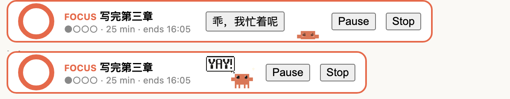

# focus-timer · 专注计时

[简体中文](README.zh-CN.md)

A compact focus countdown card above the prompt box, for the Claude desktop app (a mod / plugin). Start a round with `/focus 25 write paper`; the card keeps the time, names the one outcome of the round, counts your rounds for the day, and a small crab drops in now and then to cheer you on.



*A mock of the card (`docs/card-mock.html`), drawn from the same crab artwork as the mod; the task text is made up.*

## What it does

- **A countdown ring.** 25 minutes by default; the ring turns amber for the final fifth of the round, when effort should rise.
- **One outcome per round.** Typed by you (`/focus 25 write paper`), taken from a parked next step (`/focus note …`), or drawn from your last message and phrased by a small model (Haiku). That call sees only your last few messages, never the session, so the session's prompt cache is untouched; if it fails, the plain guess stays. In a new session, bare `/focus` asks what to focus on first.
- **Four dots for the day.** Each finished round fills one. Every fourth round earns a 15-minute break; shorter breaks are 5.
- **Breaks that say something.** Each break names one off-screen thing to do (look 6 m away for 20 s, stand up and roll your shoulders…).
- **A finish you notice.** A toast, and on macOS a system notification.
- **A crab that drops by.** Two pops at the start (冲鸭! GO!GO!GO!), a peek mid-round, a cheer for the final stretch, YAY! at the finish. It is rare and brief on purpose. The button 乖，我忙着呢 ("be good, I'm busy") sends it away for 10 minutes; `/focus crab off` sends it home.

The design choices follow the focus research cited in the code comments (goal gradient, micro-breaks, longer breaks every fourth round).

## Install

In a Claude Code session in a terminal:

```text
/plugin install focus-timer --marketplace GenLI3202/focus-timer
```

Or from a shell: `claude plugin install focus-timer --marketplace GenLI3202/focus-timer`. In the desktop app, where `/plugin` does not run: click **+** next to the prompt box, then **Plugins**, **Add marketplace** with `GenLI3202/focus-timer`, then **Add plugin**.

## Commands

```text
/focus 25 write paper     start a 25-minute round named "write paper"
/focus                    status; in a new session, asks what to focus on
/focus name <outcome>     rename this round
/focus note <next step>   park your next step; the next round starts from it
/focus break [min]        start a break
/focus pause | resume | stop
/focus +5                 add five minutes
/focus status
/focus crab on | off
```

## What it stores

Your round count and minutes per day, the parked note and the crab on/off choice, in the mod's own store on your machine. Nothing is sent anywhere, apart from the optional small-model call above and the macOS notification command.

## Develop

```bash
claude plugin test .
docs/build-images.sh      # rebuild the figure (needs Google Chrome and ffmpeg)
```

## License

MIT, see [LICENSE](LICENSE).
