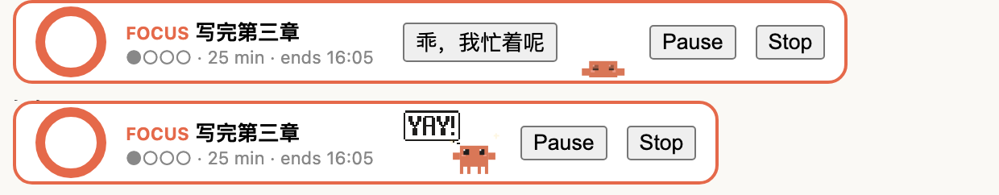

# focus-timer · 专注计时

[English](README.md)

Claude 桌面版里的一个 mod（插件）：输入框上方的一张紧凑的专注倒计时卡片。用 `/focus 25 写论文` 开一轮；卡片负责计时、给这一轮定一个明确的产出、记下你今天的轮数，一只小螃蟹偶尔会过来给你打气。



*图是卡片的模拟图（`docs/card-mock.html`），用的是 mod 里同一套螃蟹画面；任务文字是虚构的。*

## 它做什么

- **倒计时圆环。** 默认 25 分钟；最后五分之一圆环变成琥珀色，那时该加把劲了。
- **每一轮只有一个产出。** 你自己打（`/focus 25 写论文`），或取自你停车场里记下的下一步（`/focus note …`），或从你上一条消息里提取、由一个小模型（Haiku）改写成一句话。这次调用只看你最近几条消息，看不到整个会话，所以不会动会话的提示缓存；失败的话就保留原来的粗略猜测。新会话里，直接 `/focus` 会先问你要专注什么。
- **一天四个圆点。** 每完成一轮点亮一个。每第四轮奖励 15 分钟的长休息，平时休息 5 分钟。
- **休息时有话说。** 每次休息给一件离开屏幕的小事（看 6 米外 20 秒、站起来转转肩膀……）。
- **看得见的结束。** 弹出提示，macOS 上还有系统通知。
- **会来串门的螃蟹。** 开始时蹦出两次（冲鸭！GO!GO!GO!），中途探头一次，最后冲刺时欢呼，结束时 YAY!。刻意做得少而短。「乖，我忙着呢」按钮让它走开 10 分钟；`/focus crab off` 让它回家。

设计取舍参考了代码注释里引用的专注研究（目标梯度、微休息、每四轮一次长休息）。

## 安装

在终端的 Claude Code 会话里：

```text
/plugin install focus-timer --marketplace GenLI3202/focus-timer
```

也可以在命令行 `claude plugin install focus-timer --marketplace GenLI3202/focus-timer`。桌面版里 `/plugin` 不能用：点输入框旁的 **+**，选 **Plugins**，**Add marketplace** 填 `GenLI3202/focus-timer`，再 **Add plugin**。

## 命令

```text
/focus 25 写论文           开一轮 25 分钟，名叫“写论文”
/focus                    看状态；新会话里会问你要专注什么
/focus name <产出>        给这一轮改名
/focus note <下一步>      记下下一步；下一轮从它开始
/focus break [分钟]       开始休息
/focus pause | resume | stop
/focus +5                 加五分钟
/focus status
/focus crab on | off
```

## 它存什么

每天的轮数和分钟数、记下的下一步、螃蟹开关，都存在 mod 自己在你本机的存储里。除了上面那次可选的小模型调用和 macOS 的通知命令，不向任何地方发送东西。

## 开发

```bash
claude plugin test .
docs/build-images.sh      # 重新生成图（需要 Google Chrome 和 ffmpeg）
```

## 许可

MIT，见 [LICENSE](LICENSE)。
